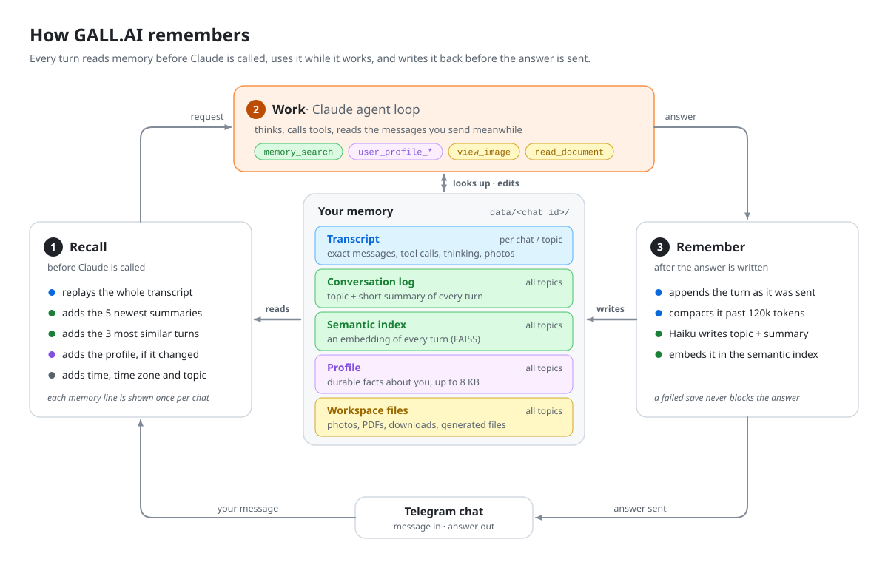
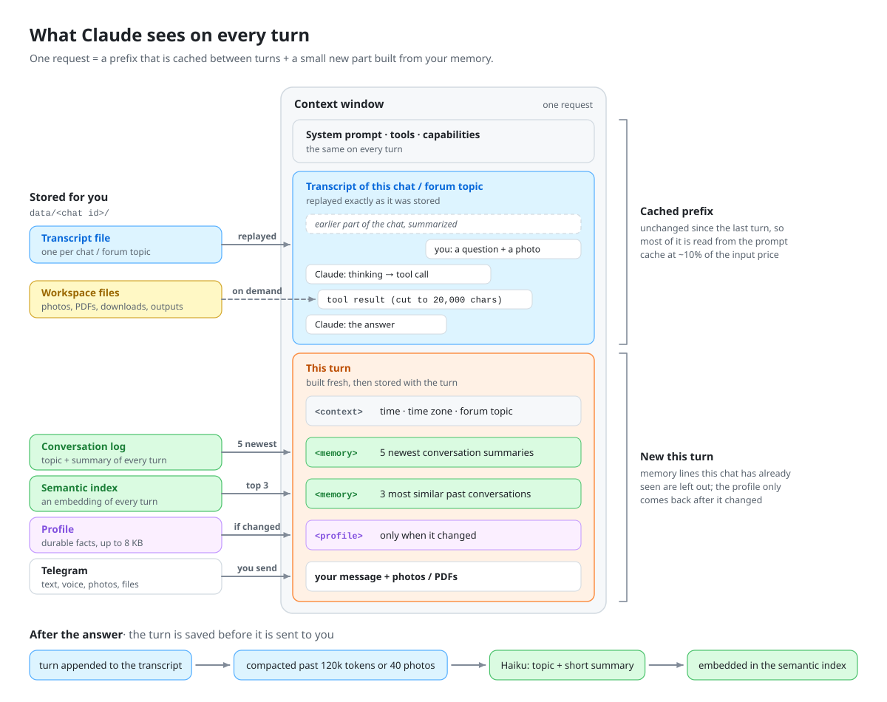
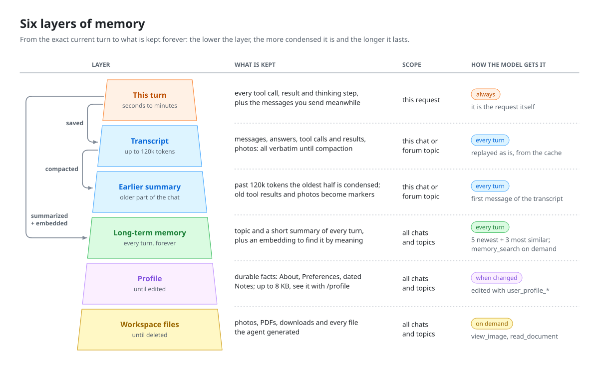

# 🤖 GALL.AI (prev. GenerALL.AI) - Multimodal Gen AI Agent System

> **Note:** GenerALL.AI refers to a "General Purpose AI", not a military general.

## ⚡ In a nutshell

**Your own AI agent in Telegram.** Write, talk or send a file: it thinks with Claude, uses 50+ tools and
answers in the same chat.

- 💬 **Understands what you send**: text, voice, photos, videos, PDFs and documents, replies and forwards
- 🧠 **Remembers you**: the current chat word for word, every past conversation as a searchable summary,
  and a profile of facts you control
- 🛠️ **Does the work**: web search and research, code in your own sandbox, a real browser that clicks,
  types and logs in
- 🎨 **Creates**: images, videos, PDF / Word / Excel documents and voice replies
- ⏰ **Works on schedule**: reminders and recurring tasks in your time zone, quiet when there is nothing new
- 🗣️ **Never blocks you**: keep writing while it works; long jobs finish in the background and report back
- 🔌 **Plugs into your tools**: any MCP server (Notion, Linear, Sentry, …) with a one-tap sign-in
- 🔒 **Safe by default**: isolated containers without access to private networks, invite-only access

## 📋 Overview

GALL.AI (General AI) is a sophisticated multimodal agent system with telegram bot communication interface powered by advanced AI models like Claude Sonnet 5.5 and GPT-6.1. It provides a seamless interface for users to interact with AI capabilities through Telegram, supporting text, voice, images, documents, and more.

## ✨ Features

- **🔄 Multimodal Support**: Process and respond to text, voice messages, photos, videos, PDFs and other document types
- **🎤 Voice Processing**: Transcribe voice messages and generate voice responses with customizable voices via ElevenLabs
- **👁️ Photos and PDFs seen directly**: pictures and PDFs reach the model as real image and document blocks, no
  description step in between; the agent can look at any file in your workspace again (`view_image`,
  `read_document`) or ask a second model for another opinion (`describe_image`)
- **📸 Multiple Photo Processing**: Send an album and the agent sees every picture at once to describe, compare or redraw
- **🖼️ More image formats**: JPG, HEIC, PNG, WebP, GIF and BMP, as photos or as files
- **💬 Replies and forwards understood**: reply to a message (yours or the bot's), quote a part of it, or forward a
  post, and the agent knows what you mean
- **🗣️ Keep talking while it works**: messages you send while the agent is busy reach it at its next step
  (👀, then ✍ once read) and it adapts; long tool calls continue in the background and the agent tells you
  when they finish
- **🎨 Image Generation**: Create new images based on text descriptions or modifications of existing images
  - **🔄 Generate with gpt-image**: Create single images and variants with OpenAI's gpt-image models (`best` / `fast` engines)
  - **✨ Multimodal Generation with Gemini**: Generate stories with matching images using Google's Gemini image models (`story` engine)
  - **🖌️ Image-to-Image Transformation**: Edit one picture or compose several into one, including photos you sent earlier
- **📄 Document Processing**: PDFs are read as documents; DOCX, XLSX, JSON, text and code files are extracted and handed to the agent
- **📝 Documents out**: the agent writes PDF, DOCX, XLSX, Markdown or HTML files from Markdown (`create_document`) and sends them to you
- **🌐 Web reading and headless browsing**: pages are reduced to their readable content; JavaScript-heavy sites are
  rendered by a headless Chromium inside the sandbox (`browse_webpage`), with an optional screenshot
- **🧭 Interactive browser**: the agent opens sites in its own Chromium, clicks, types, fills forms, signs up
  and logs in, over several pages and turns, and shows you live screenshots while it works. It asks you first
  (with a screenshot) before buying, paying, sending a message or deleting anything, and hands you captchas.
  Logins are kept between sessions until you forget them in `/sandbox`
- **🧰 Persistent sandbox**: commands run in your own long-lived container: background jobs keep running,
  installed apt/pip packages are reinstalled automatically, and it closes after 30 minutes without use
  (you get a "closing in 5 minutes" message with a Keep open button)
- **⏰ Reminder System**: reminders in natural language, one-off or periodic (down to "every weekday"), in your
  local time; `/reminders` groups them, pushes one by +1h / +1d, edits its text, and a reminder that fires comes
  with snooze buttons (10 min, 1 h, tomorrow 09:00)
- **📅 Task Scheduling**: scheduled agent tasks that run later and report back, or stay quiet when there is
  nothing new to tell you
- **🕒 Your time zone**: `/timezone` (a picker, a city name or a shared location), or just tell the bot where you
  are; it asks once when it does not know, and then shows times and schedules reminders in your local time
- **🔁 Retry on errors**: a failed answer ends with a plain-language reason (rate limit, overloaded provider,
  network, request too large) and a Retry button; transient provider errors are retried behind the scenes first
- **🔒 Secure Container System**: Run unsafe commands in isolated Docker containers that cannot reach private networks
- **💻 Terminal Access**: Execute system commands securely through the bot interface
- **📦 Package Management**: Install and run packages in a secure containerized environment
- **📁 File Sharing**: Send files directly to users through Telegram
- **📱 SMS Messaging**: Send SMS text messages to phone numbers via Twilio integration
- **⚙️ Customizable Settings**: `/settings` with three presets (⚡ Fast, ⚖️ Balanced, 🧠 Deep), a mode setting
  (quick answers vs. deep work) and an Advanced toggle for the power settings
- **🧠 Long memory**: the current chat word for word, plus a summary of every past conversation that is
  recalled by recency and by meaning ([how memory works](#-how-memory-works))
- **👤 Profile memory**: the agent keeps a short profile of durable facts about you (name, city, preferences, projects)
  that you can see and clear with `/profile`; say "remember that …" or "forget …"
- **🔌 MCP servers**: connect your own Model Context Protocol tool servers with `/mcp` (a token, or a one-tap OAuth sign-in for Notion, Linear, Sentry, …) and the agent uses their tools
- **❓ /help and a command menu**: `/help` lists what the bot can do, the commands and example prompts; the commands
  show up in Telegram's "/" menu
- **📊 /usage**: your own usage for the last 30 days (actions, tokens, estimated cost, reminders, workspace size)
- **🔌 Advanced Agent Architecture**: Powered by a modular agent system with specialized tools for different tasks
- **🔍 Web Search**: Search the web for up-to-date information using multiple providers (Perplexity, Tavily)
- **🧩 Reasoning Systems**: Multiple stages of reasoning with critique and judge mechanisms
- **☁️ Cloud Storage**: Upload and manage files on S3-compatible storage
- **💻 Code Execution**: Write and execute Python and Bash scripts in secure environments (SSH to your own servers is
  possible from the sandbox shell; there is no dedicated SSH tool)
- **💬 In-Process Communication**: Send Telegram messages, files, or reactions directly during thinking operations through tool-based interactions, not just as final bot output
- **🎟️ Invite System**: Control access through user invites with admin oversight
  - Users can create and share limited invite codes (3 per user by default, `INVITE_LIMIT`)
  - Admins have unlimited invite generation capability
  - Track invite usage and user access via admin commands
  - Automatically notify admins when new users join

## 🧠 How memory works

Every turn reads your memory before the model is called, uses it while it works and writes the turn back before
the answer is sent:



What the model receives on each turn: most of the request has not changed since the last turn and is read from
the prompt cache; only a small new part is built from your memory.



- **Transcript (short-term)**: every chat (or forum topic) has one real conversation transcript, including the
  tool calls the agent made, what they returned and its reasoning. It is replayed as is on every turn, so the
  agent remembers what it looked up and did. A tool result is cut to 20,000 characters when it arrives. When
  the transcript grows past the memory window (120k tokens by default), tool results older than the last 3
  turns are cleared and the oldest half is summarized into one message; past 40 photos the oldest ones become
  short markers. A new forum topic starts with an empty transcript. Settings: `/settings` → 🧠 Memory.
- **Long-term memory**: after each turn a short summary and an embedding of the exchange are stored
  (`text-embedding-3-small`, cosine similarity; a model change rebuilds the index by itself). On the next
  question the 5 most recent summaries and the 3 semantically closest earlier conversations are added as a
  memory block (each line only once per chat), so the agent can recall things from weeks ago even after the
  transcript was compacted. Summaries are shared by all chats and forum topics. The agent
  can also search this memory by keyword (`memory_search`) before saying it does not remember something.
- **Profile**: durable facts about you (About, Preferences, dated Notes) live in a small profile the agent
  maintains itself and sees whenever it changed. `/profile` shows it and can forget everything; "remember
  that …" and "forget …" work in conversation.
- **Pictures in memory**: the photos and PDFs you send stay in the transcript as the model saw them; old ones
  are replaced by a short marker when space is needed, and the files themselves stay in your workspace so the
  agent can look at them again.
- **Files**: everything the agent downloads, generates or writes lives in the user's workspace on disk and
  persists between sessions (`data/<chat id>/`).
- **Subagents**: for large research or independent sub-tasks the agent can delegate to subagents with a fresh
  context (`run_subagent`), several in parallel, and merge their reports; their tool calls appear indented in
  the status message and count against the turn's tool budget.
- **Prompt caching**: the static prompt and the transcript prefix are cached on the API side, so long
  conversations and tool-heavy turns cost a fraction of the uncached price; the status message shows the
  cached share per turn.

How long each layer lasts and which settings change it: [Memory layers and their settings](#-memory-layers-and-their-settings).

## 🚀 Example Scenarios

Here are some advanced scenarios that demonstrate the power and versatility of GenerALL.AI:

### 📊 Deep Research with File Export

```
User: "Research the latest developments in quantum computing in 2023-2024. Save the results as a PDF and send it to me."

Bot: "I'll research the latest developments in quantum computing and prepare a comprehensive report for you."
     [Conducts research using Perplexity and Tavily integrations]
     [Generates a structured report in Markdown format]
     [Converts to PDF]
     [Uploads to S3 storage]
     [Sends file to user via Telegram]
     "Here's your research report on quantum computing advancements in 2023-2024. I've included sections on hardware breakthroughs, algorithm developments, and industry applications."
```

### 🖥️ Remote Server Management

```
User: "Connect to my production server at ssh://user@example.com and check disk usage on all volumes."

Bot: "I'll connect to your production server and check the disk usage."
     [Runs ssh from the sandbox shell with network enabled, using the key you uploaded to your workspace]
     [Executes df -h command]
     [Formats results in a readable table]
     "Here's the current disk usage on your production server:
      Filesystem    Size    Used    Avail   Use%    Mounted on
      /dev/sda1     50G     23G     25G     48%     /
      /dev/sdb1     1T      750G    230G    77%     /data"
```

### 🔍 Security Vulnerability Scanning

```
User: "Scan my website https://example.com for common security vulnerabilities."

Bot: "I'll perform a security scan of your website. This might take a few minutes."
     [Sets up a secure container for scanning]
     [Installs and runs security tools]
     [Analyzes results and compiles a security report]
     "I've completed the security scan of your website. I found:
      - 2 potential XSS vulnerabilities in your contact form
      - Outdated SSL certificate (expires in 15 days)
      - Missing HTTP security headers
      I've attached a detailed report with recommendations for fixing these issues."
```

### 🎨 Advanced Image Generation and Transformation

```
User: "Create a story about a space explorer discovering an ancient alien civilization. Include images for each key scene."

Bot: "I'll create a multimodal story about a space explorer discovering an ancient alien civilization."
     [Generates a complete story with matching images for each key scene]
     [Sends text and images together in a coherent narrative]
     "The Stellar Archaeologist - A space explorer's journey to the lost civilization of Proxima Centauri IV..."
     [Image of a space explorer approaching an alien planet]
     "As Captain Elara approached the crystalline structures, their surfaces shimmered with an otherworldly light..."
     [Image of alien crystal structures with mysterious glowing patterns]
     
User: "This is great! Can you transform the second image to add more alien symbols and make it look more mysterious?"

Bot: "I'll transform that image to add more alien symbols and enhance the mysterious atmosphere."
     [Takes the existing image and applies the requested transformations]
     [Sends the modified image with new alien symbols and enhanced mysterious elements]
     "Here's the transformed image with additional alien symbols and a more mysterious atmosphere. I've added ancient hieroglyphs that glow with an eerie blue light and enhanced the shadowy elements to create a sense of the unknown."
```

### ⏱️ Complex Event-Based Reminders

```
User: "Monitor the NASA website and alert me when the next SpaceX launch is scheduled. Remind me 1 day before and again 1 hour before the launch."

Bot: "I'll monitor the NASA and SpaceX websites for upcoming launch information and set up the reminders for you."
     [Sets up regular monitoring of relevant websites]
     [Identifies next launch date]
     [Creates two context-based reminders]
     "I've set up monitoring for the next SpaceX launch. Currently, the next launch is scheduled for June 15th at 3:00 PM EDT. I'll remind you on June 14th at 3:00 PM and again on June 15th at 2:00 PM."
```

### 👨‍💻 Custom Code Development and Execution

```
User: "Write a Python script that analyzes a CSV file of stock prices, calculates moving averages, and generates a visualization. Use pandas and matplotlib."

Bot: "I'll create a Python script for stock price analysis with moving averages visualization."
     [Writes Python code using pandas and matplotlib]
     [Installs required libraries in a secure container]
     [Executes the code with sample data]
     [Generates visualization]
     [Sends the resulting graph and script file to the user]
     "I've created and executed a stock analysis script that:
      1. Loads CSV data using pandas
      2. Calculates 7-day and 30-day moving averages
      3. Generates a visualization with original prices and both moving averages
      4. Highlights potential buy/sell signals
      
      I've attached both the visualization and the Python script. You can modify the script 
      to use your own data by changing the file path in line 12."
```

### 🎟️ Invite-Based Access Control

```
User: "/invite"

Bot: "🎟️ New Invite Created

Share this link: https://t.me/YourBotName?start=invite_a1b2c3d4

Or use this command:
/invite a1b2c3d4

Invites remaining: 2/3"

[Later, when someone uses the invite]

New User: "/start invite_a1b2c3d4"

Bot: "✅ Invite accepted! You now have access to the bot.
     
     👋 Welcome to Generall.AI bot! Use me to get AI assistance.
     
     You can send me messages, voice recordings, or images to analyze."

[Admin receives notification]

Bot to Admin: "🔔 New user joined!
               User ID: `123456789`
               🌟 Invited by: `987654321`
               🌟 Total users: 3"
```

## 🔄 Advanced Features

### 🎨 Image Generation

One tool covers everything: describe a picture to create it, name an existing image to edit it, or
several to compose them into one. Engines are chosen by purpose — `best` for the most capable model,
`fast` for a quicker draft at the same price and lower quality, `story` for an illustrated narrative
— and quality runs from `auto` through `max`. `/settings` → 🎨 Images sets your preferred engine,
quality, size, a cap on how many variants one request may produce, and whether the model, quality and
size appear in the caption of each delivered image. The assistant follows your preference but may
pick a better engine when you ask for the best result.

Images are delivered once, as files, and the assistant embeds one inside its answer only if you ask
to see it there.

### ✨ Rich Messages

Answers are sent as **rich Telegram messages** (Bot API 10.1): real GitHub-flavored Markdown with
headings, tables, task lists, fenced code blocks, block quotes and LaTeX math, rendered natively by
the Telegram app. While the answer is being generated the draft streams with live formatting and the
model's thinking shows in Telegram's "Thinking…" block (streaming is on by default;
`STREAMING_ENABLED=false` makes answers arrive whole).

Pictures can appear inside the answer: the agent writes `` for an image
it generated, a photo you sent or a downloaded file (or an https image URL) and it renders inline at
that spot; with rich messages off the picture is sent as a separate photo after the text.

Rich messages are on by default and can be switched per chat in `/settings` → **Rich Messages**.
Turn them off if your Telegram app is too old and shows "unsupported message"; the bot then uses
classic Markdown formatting. If the Bot API server (the `telegram-bot-api` sidecar) is older than
10.1 the bot detects it once and falls back to MarkdownV2 formatting (tables as monospace blocks).

### 💬 Replies, quotes and forwards

Reply to any message to tell the agent what you mean ("translate this", "make it shorter"), quote a part
of a message to point at it, or forward a post from a channel or a contact for the agent to read. The
agent gets who wrote the referenced message (you, the assistant, a channel), when, and its text or
caption; nothing is downloaded from it, so reply with the file itself when you want a picture or a
document looked at again.

### 📥 Messages sent together are one request

Forward a few messages with a comment, or type three short lines in a row, and the agent reads them all
as one request instead of answering each one alone. A message waits 1.5 seconds for the next one, and
every new one extends the wait (30 seconds at most); a photo album still arriving is waited for too. You
see "typing…" at once, then 👀 on each message and one "📥 Got 3 messages" line, which becomes the
answer's status. `MESSAGE_WINDOW_SECONDS` sets the wait (0 turns it off).

### 🗣️ Talk to it while it works

You don't have to wait for an answer before writing again. While the agent works on your request, whatever
else you send in the same chat (or forum topic), a correction, an extra detail, a photo, a voice note or "stop,
use the other file", goes to the task it is working on:

- **👀 then ✍**: 👀 on your message means it reached the running task, ✍ means the agent has read it. The
  agent reads new messages at its next step (between two tool calls), adjusts its plan and covers them in its
  answer; a quick question may get a short reply right away while the work goes on. Whatever it did not get to
  before finishing is answered next, all of it together, in the order you sent it.
- **Long steps run in the background**: a tool call still running after 30 seconds, or after a few seconds when
  you have written something meanwhile, keeps running in the background while the agent goes on. When it
  finishes the agent is told and reads the result: inside the same task if that is still working, otherwise as
  a new "🔔 Background task finished" message (or not at all when there is nothing worth saying). The agent can
  also wait for, list or cancel these tasks.
- **Type instead of tapping**: when the agent asks a question with buttons, you can type your answer instead;
  the agent reads it as your message (✍ once read), so it can be as long or specific as you like. Browser approvals are the exception: buying, paying, sending a message or deleting something in the browser
  needs a tap on ✅ Allow; typing "yes" is not enough.
- **Stop or cancel**: 🛑 Stop ends only the current answer; messages it has not read yet are answered next and
  background tasks keep running. `/cancel` stops everything: the current task, your queued and unread messages,
  and the background tasks.

Messages in another forum topic wait their turn as before (with a short "still working on…" notice), and so
does a message sent while the bot is still downloading or transcribing an earlier one or delivering an answer.

### ⚡ Fast, Balanced and Deep

The first row of `/settings` is a preset: **⚡ Fast** (the fast model answers everything, light
reasoning, fewer tool calls), **⚖️ Balanced** (the default: a classifier gives quick questions a quick
answer and sends everything else through the full agent with deep reasoning) and **🧠 Deep** (always the
full agent with deep reasoning and more tool calls). Under it, "Quick answers vs. deep work" is the mode
alone, and the **⚙️ Advanced** toggle reveals the power settings (memory window, summaries, critique and
judge rounds, personality prompt, image variants). `/usage` hints at Fast when cost matters.

### ❓ /help, /usage and the command menu

`/help` lists what the bot can do, every command with a one-line description, a few tips and example
prompts; the same commands appear in Telegram's "/" menu. `/usage` shows your own last 30 days:
actions against your quota, requests, answers, tool calls, tokens in/out with the cached share, the
estimated cost and a 7-day cost sparkline, active reminders and the size of your workspace.

### 🧠 Memory layers and their settings



| Layer | What you can change |
|---|---|
| This turn | nothing to set: messages you send while the agent works join the turn |
| Transcript | `/settings` → 🧠 Memory → **🧵 Remember this chat in full** (off = a plain question/answer window); with **⚙️ Advanced** on, **Memory window** (120k tokens) and **Keep tool results (turns)** (3) |
| Earlier summary | made by itself when the transcript passes the memory window |
| Long-term memory | **📚 Recent summaries in memory** and **🔍 Recall similar past chats**; with Advanced on, **Summaries kept** (5) and **Recalled chats per message** (3) |
| Profile | `/profile` shows it and forgets everything; "remember that …" and "forget …" in the chat |
| Workspace files | ask the agent to list, send or delete them; `/usage` shows how much space they take |

### 👤 Profile memory

The agent keeps `profile.md` in your workspace: **About**, **Preferences** and dated **Notes**, a few
short entries each (8 KB at most, the oldest notes make room). It saves durable facts quietly as they come
up and reads the profile automatically; `/profile` shows it, with a button to forget everything, and
"remember that I prefer metric units" / "forget my old address" edit it in conversation.

### 🔌 MCP servers

Connect any Model Context Protocol server over streamable HTTP (or legacy SSE):
`/mcp add <name> <url> [token] [sse]`, `/mcp remove <name>`, `/mcp refresh`, `/mcp` to list servers with
their tool counts and ✅/⬜ toggles. The server's tools become `mcp_<server>_<tool>` for the agent, text
and image results included. An administrator can offer servers to every user through a JSON file
(`MCP_SERVERS_FILE`). Changing the server set resets the stored reasoning once; the conversation stays.

**Sign in to MCP servers (OAuth).** Hosted servers that need an account (Notion, Linear, Atlassian,
Sentry, …) take no token: `/mcp add notion https://mcp.notion.com/mcp` answers with a 🔐 *Sign in to
notion* button; you sign in in the browser, the provider sends you back to the bot's sign-in page and the
chat message turns into "✅ notion connected (N tools)". The bot registers itself with the provider,
uses PKCE, stores the tokens encrypted (`MCP_TOKEN_KEY`, in bot-only state the sandbox and the agent's file
tools cannot reach) and refreshes them by itself; when a refresh
fails a tool answers "needs you to sign in again" and `/mcp` shows 🔐 *Sign in to …* (or 🚪 *Sign out of …*
while signed in). Shared OAuth servers: each user signs in with their own account. Without a public
sign-in page (`PUBLIC_BASE_URL`, below) the browser ends on an error page after the sign-in: copy its
whole address and send it to the bot. Never forward a sign-in link: whoever completes it connects *their*
account to the bot user who asked for it (a link works once, for 10 minutes).

### 🌐 Web reading and headless browsing

`download_webpage` returns the readable main content of a page (navigation and footers stripped) and can
save it to a file. For pages that need JavaScript the agent uses `browse_webpage`: a headless Chromium
inside the sandbox loads the page with network enabled, extracts the text and the first links and can
take a screenshot the agent then looks at.

### 🧭 Interactive browser and the persistent sandbox

The agent drives a real Chromium through Anthropic's browser toolset: navigate, click, type, scroll, read the
page or its accessibility tree, find elements, use tabs. The browser runs in its own container per user, next
to your sandbox, and cannot reach private or local addresses. While it works you see one screenshot that
updates in place (turn it off in `/settings` → 🌐 Browser).

- **Asks before it matters**: purchases, payments, sending messages, deleting things and account-security
  changes need your ✅ Allow on a screenshot first (a tap: a typed "yes" does not count). Registering, logging in
  and accepting terms do not.
- **You help where only you can**: it sends you a captcha or asks for the username you want.
- **Logins persist**: cookies stay between sessions until you tap 🧹 Forget browser logins in `/sandbox`
  (or turn off "Remember logins" in `/settings`).

Commands and code run in a sandbox container that stays up while you use it, so several commands can build on
each other and background jobs keep running. Your workspace files and the packages installed with
`install_package` (apt or pip) persist; everything else goes when the sandbox closes after 30 minutes without
use. Five minutes before that you get a message with 👌 OK and ⏳ Keep open 30 min. `/sandbox` shows what
runs, when it closes, the open tabs and the saved packages, with buttons to keep it open, close it or forget
the browser logins. A session only starts when the server has the memory for it; otherwise the bot says so
(commands then run in a one-off container).

### 📝 Documents out

Ask for a report, a table or a brief as a file: `create_document` renders Markdown to **PDF**, **DOCX**,
**XLSX** (tables and CSV blocks become sheets), Markdown or HTML, saves it under your workspace's
`documents/` and sends it to you. PDF, DOCX and XLSX are rendered inside the sandbox.

### 🎤 Voice Settings
Customize voice parameters including voice model selection, stability, clarity, and style. The bot can both listen to your voice messages and respond with generated voice using ElevenLabs.

### 📄 Photos and documents

Photos are shown to the model as they are (a downscaled copy; the full-resolution file stays in your
workspace for edits), so it can read text, compare several pictures or describe a scene without a
separate description step. PDFs up to 100 pages / 20 MB are attached as documents the model reads itself;
larger PDFs are analyzed and summarized first. DOCX, XLSX, JSON and text/code files are extracted and
handed to the agent, long ones with a pointer to `read_file` for the rest. Later in the conversation the
agent can open any workspace file again with `view_image` / `read_document`, or ask another model's
opinion with `describe_image`.

### 🎨 Advanced Image Generation and Transformation

GenerALL.AI offers multiple powerful image generation and transformation capabilities:

#### 📸 gpt-image generation
Generate high-quality images and variants with OpenAI's gpt-image models (`GPT_IMAGE_MODEL` for `best`,
`GPT_IMAGE_MODEL_FAST` for `fast`), with customizable parameters:
- Control image size, aspect ratio and quality (`auto` through `max`)
- Several variants per request (capped in `/settings` → Images)
- Supports art styles, photography styles, and concept visualization

#### ✨ Multimodal Generation with Gemini
Create rich stories with matching images using Google's advanced Gemini model:
- Generate text and images simultaneously within a single cohesive experience
- Create multiple images that match the narrative flow
- Support for various artistic styles (3D digital art, photorealistic, cartoon, anime, etc.)
- Perfect for storytelling, educational content, and creative projects

#### 🖌️ Image-to-Image Transformation
Transform and edit existing images with AI:
- Add or remove elements from images
- Change styles, colors, or artistic approaches
- Apply creative modifications based on text instructions
- Useful for design iterations, creative exploration, and visual problem-solving
- Works with images the user has sent previously

### 📁 Supported Text File Types
GenerALL.AI supports processing and analysis of various file formats including:
- **Documents**: PDF, TXT, DOCX, MD
- **Data Files**: JSON, JSONL, CSV, XLSX, XLS
- **Code Files**: PY, JS, HTML, CSS, PHP, SQL
- **Configuration Files**: XML, YAML, YML, TOML, INI, CONF
- **Shell Scripts**: SH, BAT, PS1
- **System Files**: LOG

The bot can extract content, analyze structure, and help you understand the information contained within these supported file types.

### 🎬 Supported Media File Types
GenerALL.AI supports processing and analysis of various media formats including:
- **Images**: JPG, JPEG, HEIC, HEIF, PNG, WEBP, GIF, BMP (as Telegram photos or as files; everything is
  kept as JPEG in your workspace, transparency flattened on white)
- **Audio**: Telegram voice messages (transcribed); audio files (mp3, ogg, …) are saved to your workspace for the agent
- **Video**: Telegram videos and video notes, and files with MP4, MOV, AVI, MKV, WEBM, M4V, 3GP extensions

The bot can:
- **Images**: Analyze content, detect objects, read text (OCR), compare pictures and describe scenes; the model sees the picture itself
- **Audio**: Transcribe speech, answer using voice generation
- **Video**: Describe key frames and transcribe the audio track


### 💻 Code Execution Capabilities
- **🐍 Python Development**: Create, edit, and execute Python scripts in a secure environment
- **🔧 Bash Scripting**: Run Bash scripts and system commands safely
- **📦 Package Installation**: Install Python libraries and dependencies as needed
- **📊 Data Analysis**: Process and visualize data with popular libraries like pandas, numpy, and matplotlib
- **🔁 Automated Workflows**: Create scripts for repetitive tasks and automated data processing
- **🔒 Secure Execution**: All code runs in isolated containers for security
- **📋 Code Editing**: Iteratively improve code based on requirements and feedback

### 🕒 Time zone

Times are shown, and reminders scheduled, in your local time once the bot knows your zone. Set it with
`/timezone` (a picker of common zones, or `/timezone Europe/Berlin`; city and country names such as
`/timezone Kyiv` work too), by sharing your location (needs the optional `timezonefinder` package on the
server, otherwise the bot asks for the name), or simply by telling the bot where you live: it saves the zone
itself and asks once when it does not know. Until then everything is in UTC.

### ⏰ Reminder and Task System

Ask in natural language ("remind me tomorrow at 9 to call the dentist", "every weekday at 8 check the AI news
and message me only if something important happened") and the agent schedules a reminder or a periodic task
in your local time; daily tasks can be limited to certain weekdays. `/reminders` lists ⏰ Reminders and
🤖 Tasks with local times; each one has ⏰ +1h / 📅 +1d, ✏️ Edit text (type the new text as your next message),
⏸ Disable and ❌ Delete, and ➕ New explains how to create one. A reminder that fires comes with snooze buttons
(10 min, 1 h, tomorrow 09:00); snoozing a repeating reminder adds a one-off copy and leaves the series alone.
A scheduled task runs the agent with your task as its instructions; when it finds nothing new or worth telling
you, nothing is sent at all, and `/reminders` shows how many runs stayed quiet.

## 💻 System Requirements

### 🛠️ For Local Development

- Python 3.12+
- Docker and Docker Compose
- FFmpeg (for audio processing)
- Git

### 🔑 API Keys Required

- Telegram Bot Token
- Anthropic API Key (for Claude Sonnet 5.5 and Haiku 5.5)
- OpenAI API Key (for GPT-6.1 / GPT-6, gpt-image, Whisper and embeddings)
- ElevenLabs API Key (for voice synthesis)
- Google API Key (for Gemini image generation and Veo video)

## 📥 Installation

### 🐳 Using Docker (Recommended)

1. Clone the repository:
   ```bash
   git clone https://github.com/your-username/generall.ai.git
   cd generall.ai
   ```

2. Create an `.env` file based on the provided `.env.example`:
   ```bash
   cp .env.example .env
   ```

3. Edit the `.env` file with your API keys and configuration.

4. Build and start the Docker container:
   ```bash
   docker-compose up --build
   ```

### 🔧 Manual Installation

1. Clone the repository:
   ```bash
   git clone https://github.com/your-username/generall.ai.git
   cd generall.ai
   ```

2. Create and activate a Python virtual environment:
   ```bash
   python -m venv .venv
   source .venv/bin/activate  # On Windows: .venv\Scripts\activate
   ```

3. Install the dependencies (optionally `pip install timezonefinder` too, so that a shared Telegram location sets
   the user's time zone; without it the bot asks for the zone name):
   ```bash
   pip install -r app/requirements.txt
   ```

4. Create and configure your `.env` file.

5. Install FFmpeg system-wide or use the included ffmpeg-downloader.

6. Run the bot:
   ```bash
   python app/main_bot.py
   ```

## 🔄 Compatibility

- **💻 Operating Systems**: Linux (recommended for production), macOS, Windows
- **🚀 Deployment**: Docker-based deployment supported across all major platforms
- **🐍 Python Version**: 3.12+ required
- **📱 Telegram clients**: rich message rendering needs a Telegram app released after Bot API 10.1 (older apps show "unsupported message"; switch Rich Messages off in `/settings`)
- **🖥️ Hardware Requirements**: 
  - Minimum: 4GB RAM, 2 CPU cores
  - Recommended: 8GB+ RAM, 4+ CPU cores (especially for handling multiple conversations)
- **🌐 Network**: Requires internet connection for API access

## ⚙️ Configuration

The application is configured via environment variables in the `.env` file. Key configuration options include:

### 🔑 API Keys

- `ANTHROPIC_API_KEY`: API key for Anthropic Claude models
- `OPENAI_API_KEY`: API key for OpenAI GPT models
- `GOOGLE_API_KEY`: API key for Gemini AI models
- `OPENAI_API_KEY_WHISPER`: API key for OpenAI Whisper (voice transcription)
- `TAVILY_API_KEY`: API key for Tavily search integration
- `PERPLEXITY_API_KEY`: API key for Perplexity search integration
- `ELEVENLABS_API_KEY`: API key for ElevenLabs voice synthesis

### 🤖 Telegram Configuration

- `TELEGRAM_BOT_TOKEN`: Your Telegram bot token from BotFather
- `TELEGRAM_CHAT_ID`: Comma-separated list of initially allowed Telegram chat IDs
- `TELEGRAM_ADMIN_ID`: Telegram chat ID for the admin user (has unlimited invites and can list all users)

### 🧠 Agent Configuration

- Tool, critique and judge iteration limits are per-user settings (see `/settings`); the
  `MAX_AGENT_*_ITERATIONS` variables are obsolete and ignored.

### 🧩 Models

Every model name lives in `app/models.py` and can be overridden from `.env` (defaults in
parentheses; see the commented block in `.env.example`):

- `ANTHROPIC_MODEL` (`claude-sonnet-5-5`): agent loop, judge, final compile, the document fallbacks and
  `describe_image`. `ANTHROPIC_EFFORT` (`high`) is sent as `output_config.effort` when deep reasoning is on.
- `ANTHROPIC_MODEL_FAST` (`claude-haiku-5-5`): topic/summary, complexity classifier, quick answers, and the
  whole agent loop in the Fast preset (mode `speed`).
- `OPENAI_MODEL` (`gpt-6.1-sol`): critique and the `describe_image` second opinion. `VIDEO_FRAMES_MODEL`
  (`gpt-6-luna`): video frame description. Both are reasoning models and get
  `OPENAI_REASONING_EFFORT` (`high`).
- `WHISPER_MODEL` (`whisper-1`), `EMBEDDING_MODEL` (`text-embedding-3-small`, with
  `EMBEDDING_DIMENSION` `1536`; changing the model rebuilds every user's index in the background),
  `TTS_MODEL` (`eleven_multilingual_v2`).
- `GPT_IMAGE_MODEL`, `GPT_IMAGE_MODEL_FAST`, `GEMINI_IMAGE_MODEL_FLASH`, `GEMINI_IMAGE_MODEL_PRO`,
  `VEO_MODEL`, `PERPLEXITY_MODEL`: image, video and deep-research models.

### ⚙️ Concurrency

- `MAX_CONCURRENT_TURNS`: agent turns running at the same time across all users (default: 8)
- `MAX_SANDBOX_CONTAINERS`: one-off sandbox containers running at the same time (default: 4)
- `TOOL_BACKGROUND_AFTER_SECONDS`: a tool call still running after this many seconds moves to the background and
  reports when it finishes (default: 30; 0 = only when the user writes while it runs); at most 4 run per user

### 🧰 Sandbox sessions and the browser

- `SANDBOX_SESSIONS`: one persistent sandbox per user (default: true; false = a throwaway container per command)
- `SANDBOX_IDLE_SECONDS` / `SANDBOX_WARN_BEFORE_SECONDS`: closes after 30 min without use, warns 5 min before
- `SANDBOX_SESSION_MEM_MB` / `BROWSER_MEM_MB`: memory per sandbox (768) and per browser (1536)
- `SANDBOX_MEMORY_RESERVE_MB`: memory always left to the server (1536); sessions start only above it
- `SANDBOX_MAX_SESSIONS` / `BROWSER_MAX_SESSIONS`: count caps, 0 = automatic from the server's memory
  (8 GB: 8 sandboxes, 4 browsers)
- `SANDBOX_NETWORK`, `SANDBOX_SUBNET`, `SANDBOX_DNS`: the sessions' Docker network, its subnet and resolvers
- `SANDBOX_EGRESS_FILTER`: keep sandboxes off private networks and the host with iptables
  (`best_effort` default, `required`, `off`)
- `THREAD_POOL_SIZE`: worker threads for blocking work such as Docker waits and HTTP SDK calls (default: 32)
- `TURN_TIMEOUT_SECONDS`: hard limit for one message or scheduled task (default: 1800)
- `DROP_PENDING_UPDATES`: discard messages that arrived while the bot was down (default: true)
- `STREAMING_ENABLED`: stream partial answers as Telegram drafts (default: true)

### 🔌 MCP servers for everyone

- `MCP_SERVERS_FILE` (default `data/mcp_servers.json`): an optional, hand-edited JSON file
  `{"servers": [{"name", "url", "transport": "http"|"sse", "headers": {...}, "enabled": true}]}` whose
  servers are offered to every user (read-only in `/mcp`; users add their own with `/mcp add`). The bot
  keeps the discovered tools next to it in `<name>.cache.json`, refreshed at startup and by the admin's
  `/mcp refresh`. A server that needs an OAuth sign-in (`"auth": "oauth"`, or found at startup) gets its
  tools once the admin has signed in to it from `/mcp`; every user then signs in with their own account.

### 🔐 MCP sign-ins (OAuth)

- `PUBLIC_BASE_URL` (e.g. `https://gall.zor.gg`): turns on the sign-in page; providers send users back to
  `PUBLIC_BASE_URL/oauth/callback`. Unset: the copy-paste fallback.
- `OAUTH_LISTEN` (default `127.0.0.1:8090`): where the bot's small sign-in server listens, plain HTTP
  for a tunnel or a reverse proxy. Port 443 (or `OAUTH_TLS=on`) serves HTTPS with `OAUTH_TLS_CERT` /
  `OAUTH_TLS_KEY` (default `data/tls/<host>.pem` / `.key`) or, when those are missing, a self-signed
  certificate the bot generates once; `OAUTH_TLS=off` forces plain HTTP.
- `MCP_TOKEN_KEY`: the key that encrypts stored sign-ins (a Fernet key: `python -c "from cryptography.fernet
  import Fernet; print(Fernet.generate_key().decode())"`). Keep it as a secret and never lose it; without it
  the bot generates `data/.mcp_token_key` and warns. `MCP_TOKEN_KEY_OLD` (comma-separated) keeps old keys
  readable during a rotation. A lost key only signs everyone out.
- `COMPOSE_PROFILES=tunnel` and `CLOUDFLARE_TUNNEL_TOKEN`: start the `cloudflared` container (below).

### ☁️ S3 Storage Configuration

- `S3_HOST`: S3-compatible storage host URL
- `S3_ACCESS_KEY`: S3 access key for authentication
- `S3_SECRET_KEY`: S3 secret key for authentication
- `S3_BUCKET_NAME`: Name of the S3 bucket to use
- `S3_PATH_TO_STORE`: Path within the bucket to store files

### 📱 Twilio Configuration

- `TWILIO_ACCOUNT_SID`: Twilio account SID for SMS messaging
- `TWILIO_AUTH_TOKEN`: Twilio authentication token
- `TWILIO_FROM_NUMBER`: Twilio phone number to send messages from

## 🔐 Security Considerations

- The application uses secure Docker containers to run potentially unsafe commands
- User access is restricted to specified Telegram chat IDs
- API keys are stored securely in environment variables
- Docker socket is mounted to allow container management

## 📝 Usage

1. Start a conversation with your bot on Telegram; `/help` lists what it can do and a few things to try
2. Send text messages, voice recordings, photos, videos or documents; reply to or forward messages to give context
3. The bot will process your input and respond accordingly
4. Use `/settings` to pick a preset (Fast / Balanced / Deep) and customize the bot's behavior
5. Use `/timezone` (or share your location) so times and reminders are in your local time; `/reminders` to
   manage reminders and scheduled tasks (push, edit, snooze), `/profile` to see what the bot remembers about
   you, `/usage` for your last 30 days, `/mcp` to connect tool servers, `/sandbox` to see, keep open or close
   your sandbox and browser and to forget the browser logins
6. Keep writing while the agent works: it reads your new messages at its next step. Use `/cancel` to stop the
   task that is running and clear your queue (unread messages and background tasks included); 🛑 Stop under the
   status stops only the current answer
7. Use `/settings` → Rich Messages to switch between rich and classic formatting
8. While the agent works, the "Thinking…" message lists the tool calls as they run (✅ done, ⏳ running,
   ❌ failed, with a short argument preview and duration); tools requested together run in parallel.
   When the answer arrives the status is shortened into a **turn summary** kept above it: expandable
   tool calls (arguments and results), the model's thinking, tokens used, cached share and estimated
   cost. `/settings` → Turn Summary turns it off (the status is then deleted). If a turn fails, the status
   says why in plain words (rate limit, overloaded provider, network problem, request too large) with a
   🔁 Retry button; rate limits, overloads and connection errors are retried automatically before that.
9. Admins see token usage and estimated cost per user and in total in `/stats`: a dashboard image
   (messages per day by type, cost per day, top tools, top spenders or a user's hours of activity) and
   a compact text view with bars, a daily sparkline and changes against the previous 30 days.

### ⏳ Queues and isolation

Every chat has its own queue. A message you send while the agent works on a previous one in the same
chat or topic joins that task (see "Talk to it while it works"); otherwise it is answered immediately
with a short "still working on…" notice (with a Stop button) and then processed in order as its own
turn. Queues are fully isolated: a long task for one user, such
as video generation or a sandboxed command, never delays other users. `MAX_CONCURRENT_TURNS`,
`MAX_SANDBOX_CONTAINERS` and `TURN_TIMEOUT_SECONDS` in `.env` bound the whole process.

## 🚀 Deploying to production

Production is deployed by a manual GitHub Actions run (`.github/workflows/deploy.yml` plus the
`deploy/` helpers) instead of the hand-typed `ssh … && git pull && docker compose …` routine. All of
its configuration lives in the GitHub environment named **`PROD`**.

**The Deploy button**: Actions → *Deploy to production* → *Run workflow*. Pick the git ref to deploy
(branch, tag or full commit SHA; default `main`) and, optionally, tick *dry run*. If `PROD` has
*required reviewers* configured, the run pauses for their approval before it touches the server.

**Server connection** — four `SERVER_*` entries in `PROD` (secrets or variables; they never reach
the server's `.env`): `SERVER_ADDR` (IP or host name), `SERVER_USER` (`root`), `SERVER_SSH_KEY`
(an OpenSSH private key whose public half is in the server's `authorized_keys`) and
`SERVER_CODE_ROOT_PATH` (the checkout, e.g. `/opt/generall.ai/Generall.AI`). Optional:
`SERVER_SSH_PORT` (default 22) and `SERVER_KNOWN_HOSTS` (a `known_hosts` line that pins the host
key; without it the key is fetched with `ssh-keyscan` on every run).

**Application configuration**: every *other* secret and variable visible to `PROD` becomes one
`KEY=value` line of the server's `.env` (secrets win over variables with the same name; keys must
look like `TELEGRAM_BOT_TOKEN`, i.e. match `^[A-Z][A-Z0-9_]*$`). To add or change a setting, edit it
in `PROD` and deploy — no workflow change is needed, and the server's `.env` should not be edited by
hand any more (the previous file is kept as `.env.bak`). `deploy/render_env.py` quotes values as
needed and skips values containing newlines; the job log shows key names only, never values.

**First run**: start with a *dry run*. It renders the file, connects to the server and lists the keys
missing there (would be added), the keys that exist only in the server's current `.env` (would be
dropped — add them to `PROD` first) and the keys present in both. Nothing is changed on the server.

**What a real deploy does** (`deploy/remote_deploy.sh`, streamed over SSH): refuses to run if
tracked files are modified on the server; `git fetch` and checkout of the chosen ref; installs the
uploaded `.env`; `docker compose pull telegram-bot-api` (best effort), `docker compose build --pull
bot`, `docker compose up -d --remove-orphans`; then waits up to 90 s for the `bot` container to be
running and to log `is running`. If it does not, the job fails and prints `docker compose ps` and the
last log lines (the previous commit and `.env.bak` are named for a manual rollback). `data/` is never
touched, and a concurrency group runs deploys one at a time.

### 🔐 Hosting the sign-in page

MCP sign-ins return to `https://<your host>/oauth/callback`. The recommended setup is a **Cloudflare
Tunnel**: no inbound port, no certificate. In Cloudflare Zero Trust → Networks → Tunnels → *Create a
tunnel* (Cloudflared), copy the token, add a *Public hostname* `gall.zor.gg` with path `oauth/*` and
service `HTTP` → `localhost:8090` (delete an existing A record of that host first; the tunnel creates its
own DNS record). Then in `PROD`: `CLOUDFLARE_TUNNEL_TOKEN` (secret), `COMPOSE_PROFILES=tunnel`,
`PUBLIC_BASE_URL=https://gall.zor.gg` and `MCP_TOKEN_KEY` (secret, generated once). Deploy and open
`https://gall.zor.gg/oauth/health`: it answers `ok`.

Alternatives: let the bot serve HTTPS itself on 443 (`OAUTH_LISTEN=0.0.0.0:443`, a proxied DNS record):
Cloudflare SSL mode **Full** works with the bot's self-signed certificate, **Full (strict)** needs a
Cloudflare Origin Certificate saved as `data/tls/<host>.pem` and `data/tls/<host>.key`; set the mode for
that hostname with a Configuration Rule instead of changing the whole zone. **Flexible** is not supported
(it talks plain HTTP to port 80). Or put any reverse proxy in front that forwards `/oauth/` to
`127.0.0.1:8090`.

## ❓ Troubleshooting

- **🤖 Bot not responding**: Check your Telegram token and allowed chat IDs
- **🎤 Voice features not working**: Ensure FFmpeg is properly installed
- **🐳 Container issues**: Verify Docker is running and the user has appropriate permissions
- **🔑 API errors**: Check your API keys and network connection
- **✨ Answers arrive as "unsupported message"**: update the Telegram app, or turn Rich Messages off in `/settings`
- **✨ Answers have no headings/tables and the log says rich messages are not supported**: the
  `telegram-bot-api` sidecar is older than Bot API 10.1; run `docker compose pull telegram-bot-api && docker compose up -d`
- **🌐 `browse_webpage` or PDF rendering fail with import errors inside the sandbox**: the sandbox image is
  rebuilt automatically at startup when its Dockerfile or requirements changed (the log says `Building image
  secure-container:<hash>`); the first start after such a change takes several minutes
- **🔌 An MCP tool answers "unreachable"**: check the URL and token with `/mcp` (the last error is shown
  there) and `/mcp refresh <name>` after fixing the server
- **🔐 An MCP sign-in link ends on "This sign-in link has expired"**: links work for 10 minutes and once;
  tap 🔐 *Sign in to …* in `/mcp` again. No sign-in page at all: check `https://<host>/oauth/health` and the
  startup log line "OAuth callback endpoint listening on …"
- **🕒 Sharing a location answers "I can't tell the time zone"**: the optional `timezonefinder` package is not
  installed (a commented line in `app/requirements.txt`); install it, or set the zone with `/timezone <city>`
- **❌ "The AI provider is rate-limiting us" / "is overloaded"**: the bot already retried three times with
  backoff; wait a moment and press 🔁 Retry under the message

## 📄 License

GenerALL.AI is released under a custom license with the following terms:

- ✅ **Personal Use**: You may use this software for personal, non-commercial purposes.
- ✅ **Modification**: You may modify the software and create derivative works.
- ✅ **Distribution**: You may distribute copies of the original or modified software.
- ✅ **Attribution**: You must give appropriate credit to the original authors.
- ❌ **Commercial Use**: Commercial use requires explicit permission from the copyright holders.

See the [LICENSE](./LICENSE) file for complete details.

## 🧪 Tests

```bash
pip install -r requirements-dev.txt
pytest
```

## 👏 Acknowledgments

- Built with [aiogram](https://github.com/aiogram/aiogram)
- Uses AI models from Anthropic and OpenAI
- Voice synthesis powered by ElevenLabs 


## ❤️ Donation:

Become a Patron: https://www.patreon.com/zorg
Donate via Paypal: http://paypal.me/mezorg/15

##### ₿ BTC:

`bc1qyymy3ufvq3c3uq2q4927ll6x4rhvdw8gxlydwc`

##### Ξ ETH:

`0x0213A705065B193D14f1A3cd075977e28Da8F9B3`

##### 💵 USDT-TRC20:

`TG2efcamZ1767TkBfeGUn8QWaRGrLpHUxD`

##### 💵 SOL:

`B7faayiFUqM64Dgt4iUtpSfWbo4VANBs8bknSXv3e53E`

##### 💎 TON:

`UQDg07heLBcWdYO_sP6_Hc9hCu24E3v05sBJuRqc_DyWKreq`

##### 🐕 DOGE:

`D9RbkgazaGhkT4FHkJtHoh4hDxkzAZwQnK`


You can make a donation / subscription, or say thanks in Telegram: https://t.me/ZorgeR

Boosty (Donate / Subscription) : https://boosty.to/zorgg
